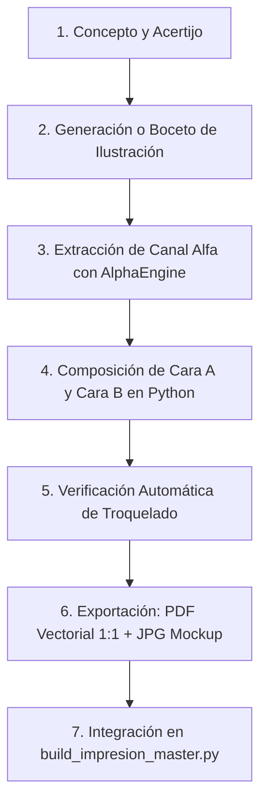

# Guía de Arte y Estilo del Diario Manuscrito (A5 Físico)

Esta guía define de manera rigurosa y exhaustiva las pautas artísticas, técnicas y de composición para cualquier página actual o futura del diario manuscrito de Silvia (*The Cartographer's Journal*).

---

## 1. Filosofía Estética: El Renacimiento de la Ilustración Técnica

El diario no es un álbum de recortes moderno ni un cómic; es el **cuaderno de campo de un maestro renacentista** (estilo Leonardo da Vinci, Johannes Kepler, Alberto Durero y Giovanni Battista Piranesi).

### 1.1. Principios Visuales Inmutables
- **Calidad "Currada" y Orgánica**: Queda terminantemente prohibido utilizar diagramas infantiles, figuras de palo, círculos vectoriales lisos sin textura o geometría esquemática básica.
- **Riqueza Mecánica y Detalle Manual**:
  - Todo instrumento astronómico, óptico o arquitectónico debe incluir detalles constructivos reales: tornillos con ranura para destornillador manual, remaches martilleados a mano, biseles de latón torneado, volutas renacentistas de hojas de acanto, escalas graduadas a buril y marcas de desgaste.
- **Técnica de Grafito y Claroscuro**:
  - Las sombras se construyen mediante **rayado cruzado (*cross-hatching*)**, tramas diagonales paralelas densas y difuminado orgánico de mina de lápiz 2B.
  - El volumen se logra mediante contrastes de luz y sombra (claroscuro), dando sensación táctil de tridimensionalidad sobre la página de papel verjurado.
- **Integración con la Página**:
  - Las ilustraciones no flotan como "pegotes" recortados; se fusionan con el fondo o descansan sobre bases de roca, pautas o líneas de horizonte que dialogan naturalmente con el texto.

---

## 2. La Evolución Estética: El Stage Path (Fase 3 — La Torre del Escenario)

A diferencia de la aridez pura del Desert Path o el frío estelar del Constellation Path, las futuras páginas del **Stage Path** introducen una atmósfera visual única inspirada en los tratados renacentistas y barrocos de escenografía teatral y óptica:

### 2.1. Elementos Visuales del Stage Path
1. **Tramoya Teatral Renacentista y Barroca**:
   - Inspiración en los tratados de **Sebastiano Serlio** (*Il secondo libro di perspettiva*), **Nicola Sabbatini** y los **Galli da Bibiena**.
   - Ilustraciones de mecanismos ocultos de madera y bronce: tambores de cuerda, poleas dentadas, contrapesos de plomo, bastidores móviles sobre raíles ranurados y telones de corte contrapesados.
2. **Óptica de Espejos y Reflexión**:
   - Espejos venecianos de marco biselado, espejos cóncavos/parabólicos de bronce pulido montados sobre trípodes renacentistas.
   - Haces de luz trazados con líneas finas de grafito punteado o continuo, mostrando la ley de reflexión y puntos focales misteriosos.
3. **Perspectiva Ilusionista (*Trompe-l'œil*)**:
   - Arcos de herradura y soportales que se desvanecen en puntos de fuga profundos y teatrales.
   - Columnas salomónicas, celosías de yesería tallada y máscaras teatrales de perfil austero y solemne.
4. **Respeto a la Paleta de Grafito Puro**:
   - Aunque la temática sea teatral, **se mantiene estrictamente el dibujo en grafito sobre papel real**. No se utilizan colores chillones, acuarelas estridentes ni elementos que rompan la ilusión del cuaderno de campo histórico.

---

## 3. Especificaciones Geométricas y Troquelado A5

El diario físico se imprime en hojas estándar **DIN A5 (148 × 210 mm)** que se perforan para un clasificador de 6 anillas. Todo diseño debe respetar matemáticamente estas restricciones para evitar que el troquelado destruya texto o arte.

```
       CARA A (Anverso / Página Impar)                CARA B (Reverso / Página Par)
       
  0 px                165 px           1748 px   0 px                1583 px          1748 px
  ┌──────────────────────┬───────────────────┐   ┌──────────────────────┬───────────────────┐
  │ ░░ TROQUELADO ░░░░░░ │                   │   │                      │ ░░ TROQUELADO ░░░ │
  │ ░░ (6 Anillas) ░░░░░ │   ÁREA SEGURA     │   │     ÁREA SEGURA      │ ░░ (6 Anillas) ░░ │
  │ ░░                   │    DE DIBUJO      │   │      DE DIBUJO       │ ░░                │
  │ ░░  0 PÍXELES        │        Y          │   │          Y           │ ░░  0 PÍXELES     │
  │ ░░  PERMITIDOS       │    CALIGRAFÍA     │   │      CALIGRAFÍA      │ ░░  PERMITIDOS    │
  │ ░░                   │                   │   │                      │ ░░                │
  └──────────────────────┴───────────────────┘   └──────────────────────┴───────────────────┘
```

### 3.1. Valores Numéricos Exactos (@ 300 DPI)
- **Ancho total del lienzo**: $1748\text{ px}$ ($148\text{ mm}$).
- **Alto total del lienzo**: $2480\text{ px}$ ($210\text{ mm}$).
- **Cara A (Anverso)**:
  - Zona de troquelado: **$X < 165\text{ px}$** ($14\text{ mm}$ desde el borde izquierdo).
  - **Invariante**: $0$ píxeles no transparentes permitidos en $X < 165\text{ px}$.
  - Margen de seguridad recomendado para contenido: empezar en $X \ge 185\text{ px}$.
- **Cara B (Reverso)**:
  - Zona de troquelado: **$X > 1583\text{ px}$** ($14\text{ mm}$ desde el borde derecho).
  - **Invariante**: $0$ píxeles no transparentes permitidos en $X > 1583\text{ px}$.
  - Margen de seguridad recomendado para contenido: terminar en $X \le 1563\text{ px}$.
- **Márgenes Verticales**:
  - Margen superior: $Y \ge 120\text{ px}$ ($10\text{ mm}$).
  - Margen inferior: $Y \le 2360\text{ px}$ ($10\text{ mm}$).
- **Excepción de Páginas Dobles (*Full-Bleed Spreads*)**:
  - Las ilustraciones de doble página que ocupan el fondo al 100% (como el Gran Mapa del Desierto o la lámina de transición de la Hoja 18B) pueden cruzar los márgenes como fondo textural continuo, pero **el texto legible, inscripciones y elementos clave del juego deben mantenerse dentro del área segura**.

---

## 4. Invariante Anti-Colisión Texto–Dibujo

La colisión entre texto y trazos gráficos degrada la legibilidad y rompe el acabado artesanal:
1. **Buffer de Seguridad Obligatorio**: Mantener un espacio libre mínimo de **40 a 80 píxeles** entre cualquier elemento caligráfico y los trazos de la ilustración circundante.
2. **Pautas de Escritura**: Si el texto descansa sobre líneas pautadas, la caligrafía debe alinearse sobre la línea base (*baseline*) sin que las astas descendentes ($g, y, p, q$) choquen de forma confusa con la línea inferior.
3. **Máscaras de Reserva (*Alpha Knockout*)**: Si una ilustración debe rodear un bloque de texto, aplicar un recorte de canal alfa suave alrededor de la caja del texto para que el grafito no compita visualmente con la lectura.

---

## 5. Ergonomía Tipográfica para Papel Real A5

Dado que Silvia leerá estas páginas en papel físico a una distancia de 30–40 cm, los tamaños de fuente deben configurarse según esta escala calibrada:

| Nivel Jerárquico | Tamaño (@ 300 DPI) | Equivalente Pt | Fuente Canónica | Uso y Contexto |
| :--- | :--- | :--- | :--- | :--- |
| **Título Principal** | **62 – 66 px** | ~15 – 16 pt | Apple Chancery | Encabezado superior de página (ej. *"The Sandstone Sanctuary"*). |
| **Subtítulos de Sección**| **42 – 48 px** | ~10 – 12 pt | Apple Chancery | Títulos de juegos, tablas o estancias. |
| **Cuerpo Narrativo** | **35 – 38 px** | ~8.5 – 9.2 pt | Apple Chancery / Fondamento | Párrafos de diario, cartas y reflexiones del Cartógrafo. |
| **Instrucciones y Pistas**| **28 – 33 px** | ~7 – 8 pt | Apple Chancery / Fondamento | Reglas de juego, acertijos y notas al margen (*marginalia*). |
| **Cotas y Micro-Notas** | **22 – 26 px** | ~5.5 – 6.5 pt | Fondamento / Monospace sutil | Grados de acimut, coordenadas celestes y numeraciones. |

> [!CAUTION]
> **Prohibición**: Queda terminantemente prohibido utilizar tamaños inferiores a **22 px**, ya que resultan ilegibles sobre papel físico rugoso tras la impresión.

---

## 6. Paleta de Colores y Canal Alfa en Python

El motor de renderizado (`AlphaEngine`) trabaja con imágenes de 4 canales (**BGRA** en OpenCV / **RGBA** en PIL):

```python
# Color canónico de grafito puro (lápiz 2B natural)
GRAPHITE_COLOR = (42, 38, 34)  # RGB: carbón cálido con toque tierra

# Variaciones tonales permitidas:
GRAPHITE_LIGHT = (75, 70, 65)  # Para líneas de pauta y tramas secundarias
GRAPHITE_DEEP  = (22, 20, 18)  # Para sellos de tinta, iniciales capitulares o sombras profundas
```

- **Transparencia Absoluta en Fondos**: Las ilustraciones fuente (`*_alpha.png`) deben tener canal alfa limpio ($A = 0$ en zonas vacías). Nunca guardar ilustraciones de stock con fondos blancos opacos que tapen el papel.
- **Opacidad del Fondo Fotorrealista**: En los mockups, la ilustración de grafito se compone multiplicativamente o mediante alpha-blend sobre la fotografía del papel real escaneado a 300 DPI (`journal/page01/real_paper_300dpi.png`).

---

## 7. Pipeline de Producción para una Nueva Hoja

Para crear una nueva hoja del diario físico (ej. Hoja 19, Hoja 20...), siga este flujo estricto:



1. **Boceto de Arte**: Generar la ilustración técnica renacentista a alta resolución ($> 2048\text{ px}$).
2. **Limpieza de Trazos**: Extraer el canal alfa eliminando el fondo blanco o papel digital con `AlphaEngine.isolate_pencil_strokes()`.
3. **Composición Programática**: Utilizar el script plantilla (`scripts/journal/templates/template_new_sheet.py`), definiendo la posición de títulos, textos y juegos.
4. **Validación de Agujeros**: El script debe verificar que $X < 165$ (Cara A) y $X > 1583$ (Cara B) tengan cero píxeles de contenido.
5. **Generación de Entregables**:
   - `journal/pageXX/pdf/pageXX_front_A5.pdf` y `pageXX_back_A5.pdf`.
   - `journal/pageXX/mockups/pageXX_front_real_paper_mockup.jpg` y `pageXX_back_real_paper_mockup.jpg`.
6. **Ensamble Dúplex**: Añadir la hoja al compilador maestro [scripts/journal/build_impresion_master.py](file:///path/to/Silvia's23/scripts/journal/build_impresion_master.py).
